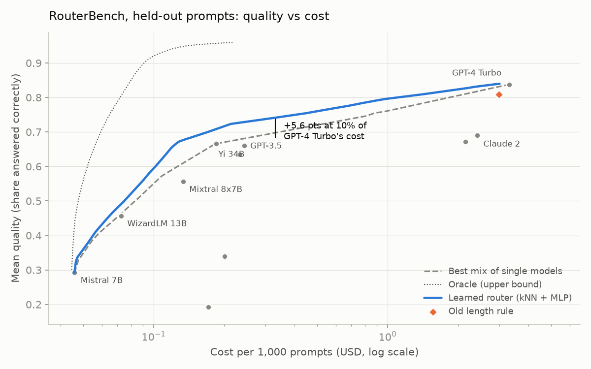
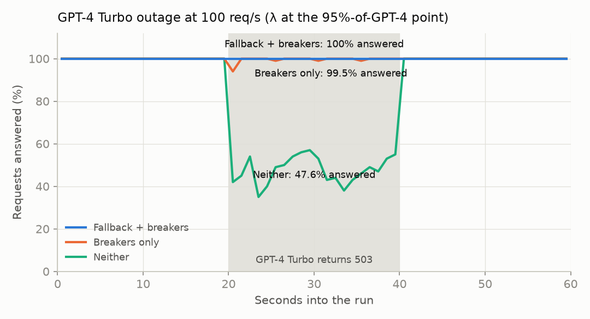
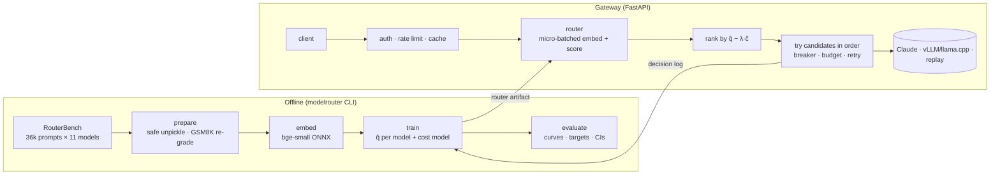

# Model Router: Cost–Quality Optimizer

A router that learns, per prompt, which LLM will answer it well, and sends it to the one with the
best expected quality per dollar. It's trained and scored on **36,478 real prompts × 11 models**
(RouterBench, with GSM8K re-graded) and served behind an **OpenAI-compatible gateway** with
ranked fallback, circuit breakers, per-tenant budgets and Prometheus metrics.

<picture>
  <source media="(prefers-color-scheme: dark)" srcset="results/figures/cost_quality_dark.png">
  
</picture>

## Results

Held-out test prompts (7,294 per split), three random splits, mean ± sd. The reference is GPT-4
Turbo, the strongest model in the pool (0.837 quality, $3.32 per 1k prompts). "Calibrated" means
λ was chosen on the validation set for the target and then applied to test, which is what a
deployment would do. Full tables, CIs and per-benchmark numbers: [docs/RESULTS.md](docs/RESULTS.md).

| Metric | Learned router (kNN + MLP) | Best mix of single models |
|---|---:|---:|
| **Cost to reach 95% of GPT-4's quality** (λ calibrated on validation; test quality in brackets) | **33.0% ± 2.5** of GPT-4's cost [95.6%] | 65.8% ± 2.5 [95.5%] |
| Same, read off the test curve | **28.1% ± 1.3** | 59.4% ± 2.7 |
| Cost to reach 90% / 98% of GPT-4's quality | **13.3% / 55.4%** | 25.6% / 83.3% |
| Quality at 10% of GPT-4's cost | **0.741 ± 0.002** | 0.685 ± 0.006 |
| Two models (Mixtral vs GPT-4): APGR | **0.655 ± 0.005** | 0.499 (random) |
| GPT-4 calls needed to recover 50% / 80% of the gap | **30% / 59%** | 50% / 80% (random) |

* **Half the cost at the same quality.** Reaching 95% of GPT-4's quality costs a third of
  GPT-4's price with the router, against two thirds for the best fixed mix of models. The
  validation-chosen λ lands on target on test (95.3–96.0% of GPT-4 across seeds), and the
  bootstrap intervals don't overlap (25.9–38.7% vs 64.0–80.9% of GPT-4's cost, seed 0).
* **Biggest gains at tight budgets.** At 10% of GPT-4's cost the router scores 5.6 points
  higher than the best mix (0.741 vs 0.685).
* **It learns where each model is good.** At the 95%-of-GPT-4 operating point it sends 59% of
  HellaSwag to Yi-34B (0.820 vs GPT-4's 0.839, at 31% of the cost) and 86% of GSM8K to GPT-3.5
  and Claude Instant (19% of the cost, giving up 11 points there), and keeps GPT-4 for most of
  MMLU and ARC
  ([breakdown](docs/RESULTS.md#where-the-traffic-goes-λ--316-random-s0-test)).
* **Exact parity is expensive.** GPT-4 is far ahead of every other model here (Claude 2 is
  next at 0.69), so matching it exactly still costs 84% of GPT-4's price (mix: 99.5%).
* **Unseen benchmarks generalise poorly.** With a whole benchmark held out of training, the
  router beats the best fixed mix on 3 of 7 (GSM8K +11 points at a 10% budget, misc +8,
  HellaSwag +1) and trails it slightly on the other 4. Two-model APGR averages 0.54, barely
  above random's 0.50. A deployment needs outcome data from its own traffic. See
  [leave-one-benchmark-out](docs/RESULTS.md#unseen-benchmarks-leave-one-benchmark-out).
* **The first version's length rule** (≥20 words → bigger model) sends most prompts to GPT-4:
  0.81 quality at 90% of GPT-4's cost, below the router's curve. In the two-model test its APGR
  is 0.58.

## Gateway

<picture>
  <source media="(prefers-color-scheme: dark)" srcset="results/figures/outage_dark.png">
  
</picture>

Measured on a 4-vCPU GitHub Actions runner ([`bench` workflow](.github/workflows/bench.yml)): one
gateway process, load generator on the same machine, replay upstreams that answer instantly, so
latencies are the gateway's own.

| | TF-IDF router | kNN + MLP router |
|---|---:|---:|
| Routing decision, one core (p50 / p99) | **0.06 / 0.17 ms** | 45 / 134 ms |
| Sustained load, one 4-vCPU process | **400 req/s, p50 2.6 ms, p99 7.6 ms, 0 errors** | ~16 req/s (embedding-bound) |
| Cost to reach 95% of GPT-4's quality (calibrated) | 36.4% of GPT-4's | **33.0%** |
| Router artifact | 2.4 MB | 36 MB |

* **The gateway serves exactly what was evaluated.** Every one of the 7,294 test prompts sent
  over HTTP got the same routing decision as the offline evaluation (100.00%, both routers, two
  values of λ), so the quality and cost above are what the gateway delivers.
* **Router choice is a real trade-off.** kNN + MLP buys about 3 points of GPT-4's cost at the
  95% target but costs ~750× more CPU per decision, because it embeds every prompt. The configs
  default to TF-IDF; kNN + MLP is one flag away (`--router-dir`).
* **Outages don't reach clients.** With GPT-4 returning 503 for 20 s at 100 req/s (λ at the
  95% point, where GPT-4 gets about half the traffic), ranked fallback plus breakers answered
  100% of requests, 1,054 of them from the next-best model. Breakers alone lost 9 requests
  before opening. With neither, 17.5% of all requests (52% during the outage) failed.
* **Production pieces:** per-tenant bearer keys, token-bucket rate limits and daily dollar
  budgets in Redis (atomic Lua; reserve before the call, settle after), exact-match caching,
  streaming with pre-first-byte fallback, Prometheus metrics with a provisioned Grafana
  dashboard, a non-root read-only container, and a Helm chart (HPA, PDB, probes).

## How it works



1. **Predict quality per model.** For each prompt the router estimates `q̂[m]`, the probability
   that model `m` answers it well. Five predictors are compared: TF-IDF ridge on the prompt's
   words, and kNN, logistic, MLP and kNN + MLP on a bge-small embedding. The ensemble is best
   on every seed; TF-IDF is nearly as good and ~750× cheaper to run.
2. **Predict cost per model** from prompt length (a per-model linear fit on realised costs).
3. **Pick** `argmax q̂[m] − λ·ĉ[m]`. λ is the price of quality: it can be set per tenant or per
   request, or calibrated to a quality target or budget on validation data.
4. **Serve.** The gateway ranks *all* models by that utility and tries them in order, so an
   outage, rate limit or refusal moves the request to the next-best model.

Design rationale and trade-offs: [docs/DESIGN.md](docs/DESIGN.md).

## Data

[RouterBench](https://huggingface.co/datasets/withmartian/routerbench) (0-shot, pinned revision
and SHA-256): MMLU, HellaSwag, GSM8K, ARC, Winogrande, MBPP, MT-Bench and a set of OpenAI-evals
tasks, with every model's answer, score and cost. Two fixes before use:

* **Safe loading.** The dataset ships as a pickle, and unpickling runs arbitrary code. A static
  opcode scan (`scripts/pickle_globals.py`) found the 11 pandas/numpy reconstructors the file
  needs. It's loaded with an unpickler that resolves only those (`data/safe_pickle.py`), so the
  file can't execute anything.
* **GSM8K re-grading.** RouterBench scores GSM8K on a 5-level grade, and GPT-4's correct answers
  mostly get 0.75. All 7,450 × 11 responses were re-graded by exact match against the official
  answers. The usual last-number rule under-counts chat models that restate the givens
  (GPT-4: 84.4% vs 93.1% with the concluding-sentence extractor used here). A hand audit of 36
  random responses found no extraction errors.

## Quick start

```bash
uv sync --all-extras
uv run modelrouter data prepare      # download pinned RouterBench + GSM8K, build data/processed
uv run modelrouter embed             # ~36k prompt embeddings (cached; ~20 min on 4 vCPUs)
uv run modelrouter evaluate          # 3 random splits + leave-one-benchmark-out -> results/
uv run modelrouter report            # docs/RESULTS.md + results/summary.json
```

Serve a router over the recorded answers (no API keys, $0; TF-IDF needs no embeddings):

```bash
uv run modelrouter train --router tfidf --split random-s0
uv run modelrouter gateway build-replay --split random-s0 --part test
uv run modelrouter serve --config deploy/gateway.replay.yaml --port 8080
```

```bash
curl -s localhost:8080/v1/router/decide -H "Authorization: Bearer sk-bench-local" \
  -H "content-type: application/json" \
  -d '{"messages":[{"role":"user","content":"Write a function to reverse a linked list."}],"router":{"lambda":31.6}}'
```

`/v1/router/decide` returns the full ranking without calling a model. `/v1/chat/completions`
returns a normal chat completion plus a `routing` block: the chosen model, predicted quality and
cost, actual cost, and every attempt. With the replay config it only answers prompts from the
fixture (the test split), since replay serves recorded answers.

With the artifacts above built, `docker compose -f deploy/compose.yaml up --build` runs the
gateway with Redis, Prometheus and a provisioned Grafana dashboard. Kubernetes:
`deploy/helm/modelrouter`.

To route between your own models (e.g. a local vLLM model and Claude, see
`deploy/gateway.example.yaml`), collect outcomes for them in the same format (prompts × models →
quality, cost) and retrain. The router only knows the models it was trained on.

## Repository layout

| Path | What |
|---|---|
| `src/modelrouter/data/` | RouterBench download and verification, safe unpickling, GSM8K grading, splits |
| `src/modelrouter/features/` | ONNX sentence embeddings with content-hash caching |
| `src/modelrouter/routers/` | quality models, cost model, λ policy, save/load |
| `src/modelrouter/eval/` | metrics (hull, AIQ, targets, APGR/CPT, bootstrap), harness, figures, report |
| `src/modelrouter/gateway/` | FastAPI app, providers (Anthropic SDK, OpenAI-compatible, replay), breakers, limits, batching |
| `bench/` | open-loop load generator, router latency, offline vs gateway comparison |
| `deploy/` | Dockerfile, Compose stack, Grafana dashboard, Helm chart, gateway configs |
| `.github/workflows/` | `ci` (lint, types, tests); `bench` (load and fault tests on a clean runner) |

## Limitations

* The 11 models are from 2023. The method and code are model-agnostic, but these numbers are
  about this pool, where one model (GPT-4) is far ahead of the rest.
* Quality means benchmark correctness (judge scores for MT-Bench and a few open-ended tasks).
  Production quality needs its own labels; the decision log is the starting point.
* Costs are RouterBench's recorded per-answer costs at 2023 prices.
* Gains on benchmarks the router never saw are small. The honest deployment loop is: log
  decisions, label a sample, retrain.

## What changed from the first version

The first version classified prompts by word count and scored the routes against synthetic
prompts generated from the same word counts, so routing was correct by construction and no answer
was ever graded. Its savings figures came from a blog post, and its sample output wasn't produced
by the code. This version measures real answers end to end; the old rule is kept as a baseline.
